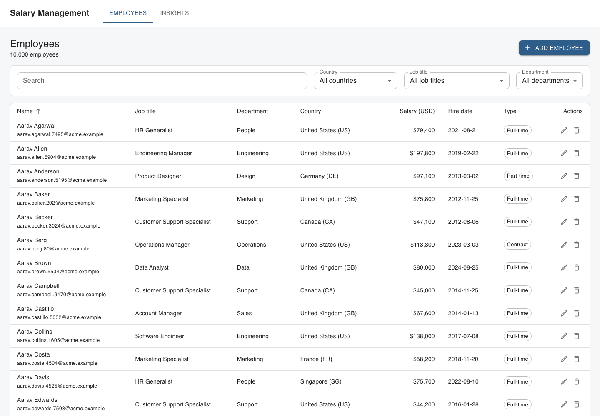
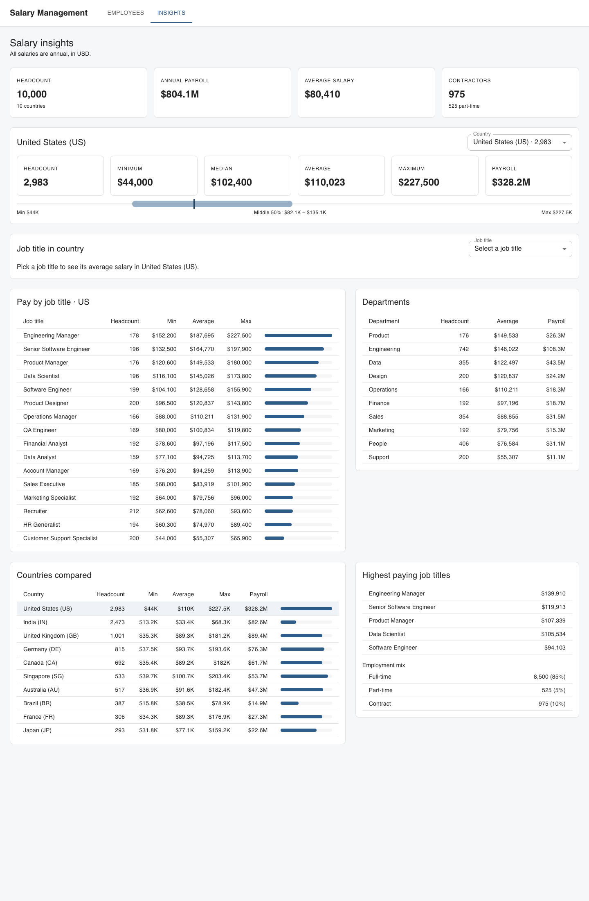

# Salary Management

A minimal but usable salary management tool for an HR Manager in a 10,000-employee organization.

- **Manage employees:** add, view, edit and delete. Includes search, filters, sorting and server-side pagination.
- **Salary insights:**
  - Min, max, average and median salary per country.
  - Average salary for a job title in a country, compared with the country average.
  - Breakdowns by job title and by department, a comparison across countries, the highest-paying titles and the employment mix.
- **Fast seeding:** 10,000 employees in about 0.9s, deterministic and safe to rerun.

| Layer | Tech |
|---|---|
| API | Ruby on Rails 8.1 (API mode), MySQL 8+ |
| UI | React 19 + TypeScript (Vite), MUI component library |
| Tests | RSpec (80 examples, 99% line coverage), Vitest + React Testing Library (32 tests) |




## Quick start (local)

Prerequisites: Ruby 3.3, Node 20+, MySQL 8+ running locally. The default is `root` with no password on 127.0.0.1:3306; override with `DB_HOST`, `DB_USERNAME` and `DB_PASSWORD`.

```bash
# API
cd backend
bundle install
bin/rails db:prepare
bin/rails db:seed            # 10,000 employees (SEED_COUNT=n to change)
bin/rails server -p 3000

# UI (new terminal)
cd frontend
npm install
npm run dev                  # http://localhost:5173, proxies /api to :3000
# API on another port?  API_PROXY_TARGET=http://localhost:3001 npm run dev
```

## Running the tests

```bash
cd backend && bundle exec rspec        # model, query, service and request specs, plus a SimpleCov report
cd frontend && npm test                # unit and component tests
cd frontend && npm run build           # type-check and production build
cd backend && bundle exec rubocop && bundle exec brakeman
```

## Docker / deployment

```bash
docker compose up --build
docker compose exec api bin/rails db:seed
open http://localhost:8080
```

`docs/DEPLOYMENT.md` explains how to deploy to a PaaS such as Render or Fly.io, with managed MySQL.

## API

| Method | Path | Description |
|---|---|---|
| GET | `/api/v1/employees` | List. Params: `q`, `country`, `job_title`, `department`, `sort`, `direction`, `page`, `per_page` (≤100) |
| GET | `/api/v1/employees/:id` | Show |
| POST | `/api/v1/employees` | Create. Body: `{ "employee": { ... } }` |
| PATCH | `/api/v1/employees/:id` | Update |
| DELETE | `/api/v1/employees/:id` | Delete |
| GET | `/api/v1/insights/overview` | Org KPIs, per-country summary, top-paying titles, employment mix |
| GET | `/api/v1/insights/countries/:country` | Min, max, avg, median, p25, p75 and headcount, plus job-title and department breakdowns |
| GET | `/api/v1/insights/job_title?country=IN&job_title=Data%20Scientist` | Average for one title in one country, compared with the country average |
| GET | `/api/v1/meta/filters` | Distinct countries, job titles, departments and employment types |

Errors are JSON: `404 {error}`, `400 {error}` for missing or invalid params, and `422 {errors: {field: [messages]}}`.

## Repository layout

```
backend/
  app/models/employee.rb            validations, normalization, scopes
  app/queries/employees_query.rb    filter, search, sort whitelist, pagination
  app/services/salary_insights.rb   analytics (SQL aggregates and percentiles)
  app/services/employee_seeder.rb   bulk, deterministic seeding
  app/serializers/                  explicit JSON contract
  app/controllers/api/v1/           thin controllers
  db/seed_data/                     first_names.txt, last_names.txt
  spec/                             models, queries, services, requests
frontend/
  src/api/                          typed fetch client and endpoints
  src/pages/                        EmployeesPage, InsightsPage
  src/components/                   form dialog, confirm dialog, stat cards, bars
  src/hooks/                        useAsync (stale-safe), useDebouncedValue
docs/                               plan, architecture, trade-offs, performance, AI usage, demo script
```

## Design artifacts

- [docs/PLAN.md](docs/PLAN.md): requirements mapped to features, and the TDD sequence
- [docs/ARCHITECTURE.md](docs/ARCHITECTURE.md): diagrams, data model and request flow
- [docs/TRADEOFFS.md](docs/TRADEOFFS.md): decisions and alternatives
- [docs/PERFORMANCE.md](docs/PERFORMANCE.md): seed benchmarks, index and EXPLAIN analysis
- [docs/AI_USAGE.md](docs/AI_USAGE.md): how AI was used and how its output was verified
- [docs/DEPLOYMENT.md](docs/DEPLOYMENT.md): how to deploy
- [docs/DEMO_SCRIPT.md](docs/DEMO_SCRIPT.md): walkthrough for the video demo
