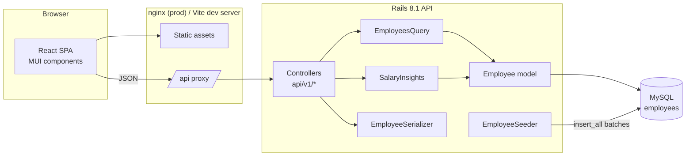
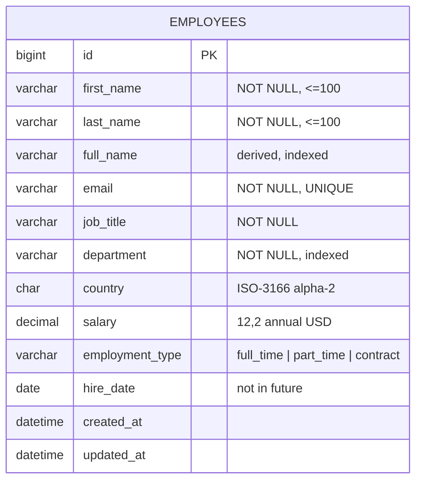
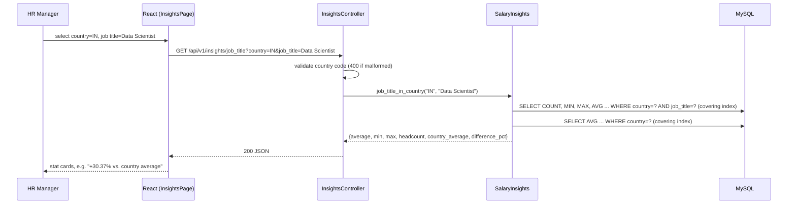

# Architecture

## Components

### Backend layering

| Layer | Responsibility | Why |
|---|---|---|
| Controllers (`Api::V1::*`) | Parse params, call one domain object, render | Thin and easy to test through request specs |
| `BaseController` | `rescue_from` for 404, 400 and 422, and turns off implicit param wrapping | One consistent error contract |
| `EmployeesQuery` | Filter, search, sort and paginate | Keeps list-screen logic out of the model and controller. Unit tested without HTTP |
| `SalaryInsights` | All analytics | A single read-model service, so SQL aggregation can be optimized in one place |
| `EmployeeSerializer` | JSON shape | An explicit contract with no extra dependency |
| `EmployeeSeeder` | Bulk data generation | Reused by `db/seeds.rb` and tested directly |

### Frontend structure

- `api/client.ts`: a fetch wrapper that maps 422 responses to `ApiError.fieldErrors`, which the form shows inline.
- `hooks/useAsync.ts`: data loading that ignores stale responses, so fast typing or filtering never renders results out of order. It keeps the previous data while reloading, which avoids flicker.
- The pages take an `api` prop, defaulting to the real client. Tests inject mocks with no global fetch mocking or MSW, which keeps them fast and deterministic.
- Plain CSS bars and a box-plot strip instead of a charting library keep the bundle small.

## Data model

Indexes:
- `UNIQUE(email)`
- `(country, job_title, salary)`: a covering index for every country and country-plus-title aggregate
- `(job_title, salary)`: org-wide title rankings
- `(department)`
- `(full_name)`: sorting and paging the list

## Request flow: "Average Data Scientist salary in India"

